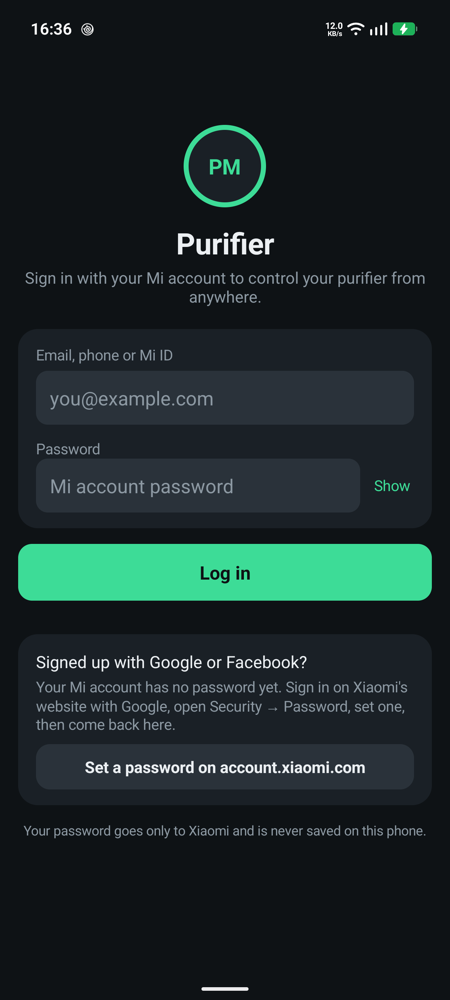

# Purifier Lite

A tiny Android app (and home-screen widget) for the **Xiaomi Smart Air Purifier 4 Lite** (`zhimi.airp.rmb1`).
It does what you actually open Xiaomi Home for: see the air quality and control the purifier from anywhere.

- 37 KB APK, no libraries, no ads, no tracking, no background services
- Works remotely (home Wi‑Fi, mobile data, anywhere) through Xiaomi's cloud, the same way Xiaomi Home does

<p>
  
  
  
  
</p>

## Features

- Animated PM2.5 ring, using the same colours as the purifier's own light (Xiaomi 4 Lite manual: green 0–20, yellow 21–35, orange 36–55, red 56+). Tap it to see what each level means and where you are now
- Humidity, temperature, filter life and days left
- Power, mode (Auto / Sleep / Favorite), fan speed (shown in Favorite, the only mode where it applies)
- Display brightness, child lock, beep
- Warnings: device fault, filter almost worn out, poor air while the purifier is off, purifier offline
- Keeps the air sensor reporting while the purifier is off (sends the purifier's "AQI update heartbeat" on every refresh)
- Pull down to refresh, plus auto-refresh every 30 s while open
- Light / Dark / Auto theme, light haptic tap feedback, small animations
- Home-screen widget: PM2.5, mode, humidity and temperature, a power button and refresh
- Finds your server region automatically (an India account can keep its devices on `in` or `i2`)

## Install (no developer options needed)

1. Get `purifier.apk` onto the phone: send it to yourself on WhatsApp/Telegram/Drive/email, or copy it over USB.
2. Tap the file. Android will ask to **allow installs from this source** (Files / Chrome / WhatsApp). Allow it once.
3. Tap **Install**. You can switch that "unknown sources" permission off again afterwards.

Play Protect may warn that it's an unknown app. That's normal for any app not from the Play Store. Tap *Install anyway*.

**Widget:** long-press the home screen, choose **Widgets**, then drag **Purifier** onto the home screen.

### Logging in
Use your Mi account **email/phone/Mi ID + password**.
If you signed up with **Google**, your account has no password yet. Sign in at
[account.xiaomi.com](https://account.xiaomi.com) with Google and set one under *Security → Password*.
If Xiaomi asks for verification, a browser page opens. Finish it there, then tap *Log in* again.

Your password is never stored, only the login session (in the app's private storage).

## Purifier Lite vs Xiaomi Home

Measured on the same phone (Android 17), cold start = `adb shell am start -W`, memory = `dumpsys meminfo` TOTAL PSS after loading,
CPU = process CPU time over 30 s with the app open.

| | Purifier Lite | Xiaomi Home |
|---|---|---|
| Download size | **~40 KB** | _to measure_ |
| Cold start | **~96 ms** | _to measure_ |
| Memory (PSS) | **~49 MB** | _to measure_ |
| CPU, open, purifier off | **~0.6 % of one core** (incl. auto-refresh) | _to measure_ |
| CPU, open, purifier on | **~9 % of one core** (dust animation at ~22 fps); nothing when closed | _to measure_ |
| Runs in background | no (the widget wakes up every 30 min, or when tapped) | _to measure_ |
| Permissions | **1: Internet** | _to measure_ |

Permissions in detail:
- **Purifier Lite** asks for **Internet only**, which it needs to reach Xiaomi's cloud. No location, Bluetooth, camera,
  microphone, contacts, storage, notifications or "run at startup". (Android 17 also lists *local network access*
  for every app that has Internet; the app doesn't use it and it isn't granted.)
- **Xiaomi Home**: _to measure_, read from the installed app with `adb shell dumpsys package com.xiaomi.smarthome`.

**Why it's lighter:** it's a single screen built from Android's own views, with no web views, no plugin framework,
no analytics SDKs, no image loading and no third-party libraries. It talks straight to one API and only for your purifier.

**What Xiaomi Home does that this doesn't:** adding or pairing new devices, firmware updates, other device types,
scenes/automations, sharing devices with family, and voice-assistant linking. Keep Xiaomi Home for setup, then use this every day.

## Limitations

- Supports the Air Purifier 4 Lite (`zhimi.airp.rmb1`). **Several 4 Lites on one account each get their own controls**; the widget shows the first one. Other models are listed as "not supported yet".
- Live fan RPM isn't available: the 4 Lite reports a stale RPM value to the cloud, so the app doesn't show it.
- The widget updates every 30 minutes (Android's minimum), when you tap ↻, or when you leave the app.
- Needs internet; it doesn't control the purifier over local Wi‑Fi.

## Build

No Gradle and no Android Studio. Needs the Android SDK (build-tools 35, platform 34) and a JDK.

```sh
./build.sh           # builds purifier.apk
./build.sh install   # builds, installs over USB (adb) and launches
```

Files:
- `src/lite/purifier/Cloud.java` is the Xiaomi cloud client (login, RC4-signed MIoT API, purifier properties)
- `src/lite/purifier/MainActivity.java` is the app screen
- `src/lite/purifier/Widget.java` is the home-screen widget
- `res/` holds the widget layout and drawables

The purifier's property IDs come from its public MIoT spec:
<https://miot-spec.org/miot-spec-v2/instance?type=urn:miot-spec-v2:device:air-purifier:0000A007:zhimi-rmb1:2>

Updates must be signed with the same key (`~/.android/debug.keystore`), or Android will refuse to install over the old version.

## Made with Claude Code

Every line in this repo was written by [Claude Code](https://claude.com/claude-code) (Anthropic's Claude Opus 5.5) in a single
conversation, from plain-language requests: the Xiaomi cloud login and encrypted API client, the app UI, the animated PM2.5 ring,
the widget, the build script and this README. The person behind it described what they wanted, tested it on their phone and steered.
Claude Code read the purifier's public spec, built and installed the app over USB, checked it with screenshots, and measured the numbers above.

## References

Used to build this, and useful for adding features or other purifier models:

- **Purifier 4 Lite control spec** (every property and its ID): [miot-spec.org: zhimi-rmb1](https://miot-spec.org/miot-spec-v2/instance?type=urn:miot-spec-v2:device:air-purifier:0000A007:zhimi-rmb1:2)
- **All Xiaomi device specs** (to add another model, find its `model` here): [miot-spec.org instance list](https://miot-spec.org/miot-spec-v2/instances?status=all) · [home.miot-spec.com](https://home.miot-spec.com)
- **PM2.5 light-ring colours**, Xiaomi 4 Lite manual: [copy 1](https://manuals.plus/m/fed300c525f5c55d1b87965d8a602b0759707833f854db617a5388eb817006d9) · [copy 2](https://manuals.plus/m/e336ffbb5768d0babc3768561279abd0080439ab50c00d0f2ef43dd4b03da60d)
- **Red band (> 55 µg/m³)**, Xiaomi Air Purifier 4 manual: [manuals.plus](https://manuals.plus/m/b38a75159a58d928a269e5e66c37dad2d2ff20a4e51694ccd3f7b933b91e1770)
- **Xiaomi support FAQ, 4 Lite**: [mi.com](https://www.mi.com/global/support/faq/details/KA-691592)
- **Xiaomi's official Home Assistant integration** (open-source reference for the cloud API): [XiaoMi/ha_xiaomi_home](https://github.com/XiaoMi/ha_xiaomi_home)
- **Cloud login + RC4-signed API, same scheme as `Cloud.java`**: [PiotrMachowski/Xiaomi-cloud-tokens-extractor](https://github.com/PiotrMachowski/Xiaomi-cloud-tokens-extractor)
- **Local (LAN) control without the cloud**: [rytilahti/python-miio](https://github.com/rytilahti/python-miio)
