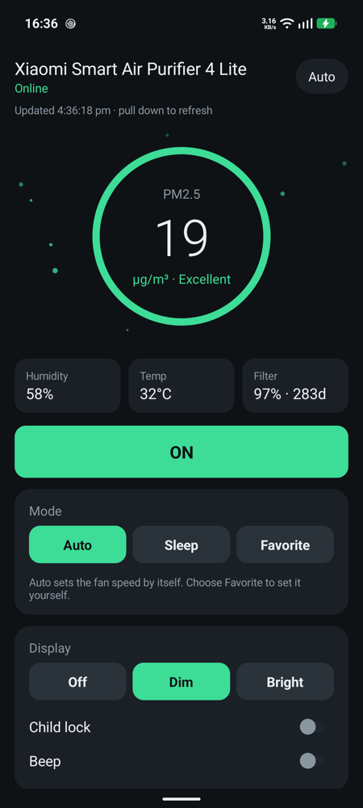
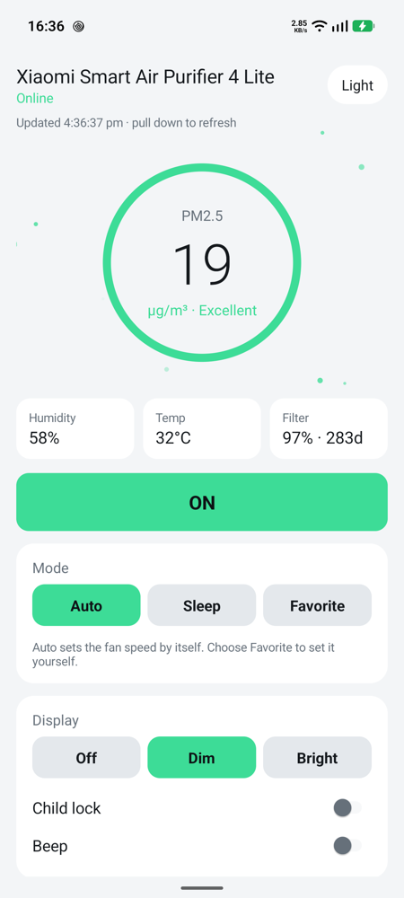
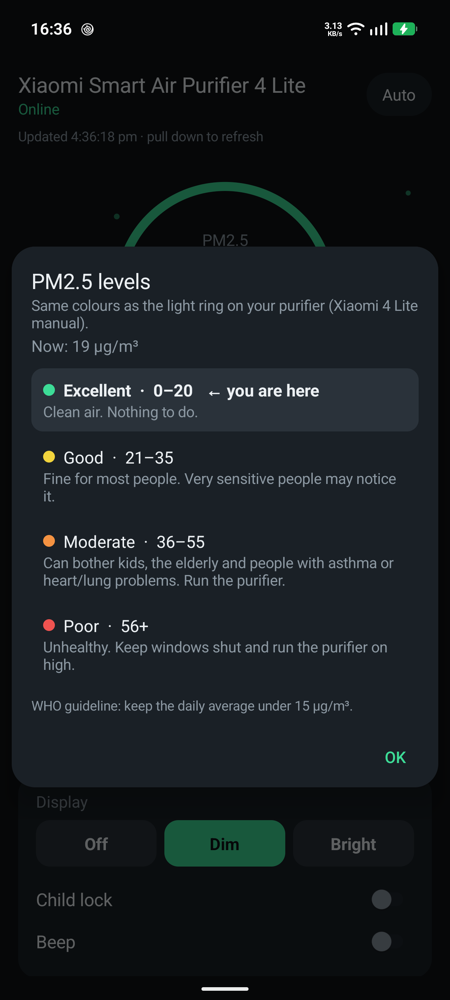

# Purifier Lite

A tiny, **unofficial** Android app (and home-screen widget) for the **Xiaomi Smart Air Purifier 4 Lite** (`zhimi.airp.rmb1`):
a lightweight alternative to the Xiaomi Home (Mi Home) app.
It does what you actually open Xiaomi Home for: see the air quality and control the purifier from anywhere.

- **45 KB** APK (Xiaomi Home: 355 MB), no libraries, no ads, no tracking, no background services
- **[Download the APK](../../releases/latest)**
- Works remotely (home Wi‑Fi, mobile data, anywhere) through Xiaomi's cloud, the same way Xiaomi Home does

<p>
  
  
  
  
</p>

## Features

- Animated PM2.5 ring, using the same colours as the purifier's own light (Xiaomi 4 Lite manual: green 0–20, yellow 21–35, orange 36–55, red 56+). Tap it to see what each level means and where you are now
- Humidity, temperature, filter life and days left
- Power, mode (Auto / Sleep / Favorite), fan speed (shown in Favorite, the only mode where it applies)
- Display brightness, child lock, beep
- Warnings: device fault, filter almost worn out, poor air while the purifier is off, purifier offline
- Keeps the air sensor reporting while the purifier is off (sends the purifier's "AQI update heartbeat" on every refresh)
- Pull down to refresh, plus auto-refresh every 30 s while open
- Light / Dark / Auto theme, light haptic tap feedback, small animations
- Home-screen widget: PM2.5, mode, humidity and temperature, a power button and refresh
- Finds your server region automatically (an India account can keep its devices on `in` or `i2`)

## Install (no developer options needed)

1. Download **`Purifier-Lite.apk`** from [Releases](../../releases/latest) on the phone, or send the file to yourself on WhatsApp/Telegram/Drive/email.
2. Tap the file. Android will ask to **allow installs from this source** (Files / Chrome / WhatsApp). Allow it once.
3. Tap **Install**. You can switch that "unknown sources" permission off again afterwards.

Play Protect may warn that it's an unknown app. That's normal for any app not from the Play Store. Tap *Install anyway*.

**Widget:** long-press the home screen, choose **Widgets**, then drag **Purifier** onto the home screen.

### Signing in
- **Sign in on Xiaomi page** (recommended) opens Xiaomi's own sign-in page inside the app. Verification codes (email/SMS)
  and captchas work there. When you're done, the app keeps only the session.
- **Email and password** is also available below it. If Xiaomi asks to verify, use the Xiaomi page button instead.
- Signed up with **Google or Facebook**? Your Mi account has no password yet. Sign in at [account.xiaomi.com](https://account.xiaomi.com)
  with Google, set a password under *Security → Password*, then use it here. (Google blocks its own sign-in inside apps.)
- Xiaomi limits verification codes per day. If it says *attempts remaining: 0*, wait about a day and try once more.

Your password is never stored. The session is kept in the app's private storage and excluded from phone backups.

## Purifier Lite vs Xiaomi Home

Measured on the same phone (Android 17), same account, same purifier, on 18 Nov 2026.
Purifier Lite 1.0 release build vs Xiaomi Home 11.9.704 from the Play Store, both logged in.

| | Purifier Lite | Xiaomi Home | Difference |
|---|---|---|---|
| App size | **45 KB** | 355 MB | ~7,700× smaller |
| Opening time (cold start, avg of 3) | **~93 ms** | ~450 ms | ~5× faster |
| Memory while open (PSS, all processes) | **45 MB** | 354 MB | ~8× less |
| Processes | **1** | 3–4 | |
| CPU while open | 11 % of one core¹ | 12 % of one core² | about the same |
| CPU after leaving the app (60 s) | **~0.1 %** | ~1 % | |
| Keeps running in the background | **no services** (Android may keep it cached, idle) | **4 services, 3 processes**, still using CPU | |
| Permissions requested | **2**³ | **86** | |

¹ On the purifier screen with the dust animation running (purifier on). With the purifier off: ~0.6 %.
² On its home screen (device list).
³ Internet, plus *local network access*, which Android 17 adds automatically to every app with Internet; it isn't granted or used.

How it was measured (so anyone can repeat it):
- **Size:** total of the installed APK files (`adb shell pm path` + `stat`)
- **Opening time:** `adb shell am start -W`, after a force-stop, 3 runs (time to first frame)
- **Memory:** sum of `dumpsys meminfo <pid>` TOTAL PSS for every process of the app, 15 s after opening
- **CPU:** process CPU time from `/proc/<pid>/stat` over 30 s (open) and 60 s (after pressing Home)
- **Permissions:** `adb shell dumpsys package <package>`

### Permissions in detail

**Purifier Lite:** Internet only, which it needs to reach Xiaomi's cloud. Nothing else.

**Xiaomi Home** asks for 86, including:
- **Location** (fine + coarse), granted on this phone
- **Camera** and **microphone** (`RECORD_AUDIO`)
- **Bluetooth** (scan, connect, advertise) and **nearby Wi‑Fi devices**, **NFC**
- **Phone state**, including *privileged* phone state
- **Accounts on the device** (`GET_ACCOUNTS`)
- **Storage / media** (audio, photos)
- **Draw over other apps** (`SYSTEM_ALERT_WINDOW`)
- **Notifications**, granted on this phone
- **Exact alarms**, set alarms, **foreground services** (connected device, data sync), wake lock
- **Advertising ID** (`AD_ID`) and Play install referrer
- Add/remove home-screen shortcuts

Most of these exist for features Purifier Lite doesn't have (pairing new devices over Bluetooth/Wi‑Fi, cameras, scenes),
which is the point: if all you need is your purifier, you don't need to give an app any of them.

**Why it's lighter:** it's a single screen built from Android's own views, with no plugin framework, no analytics SDKs,
no image loading and no third-party libraries (a web view appears only for Xiaomi's sign-in page, once). It talks straight
to one API, only for your purifier, and nothing runs after you close it.

## Compromises: what's not here

Purifier Lite is for **daily use** of a purifier that's already set up. Keep Xiaomi Home installed (or reinstall it when needed) for the rest.

**Needs Xiaomi Home:**
- **Adding or pairing a new device**, Wi‑Fi setup, moving the purifier to a new Wi‑Fi network
- **Firmware updates** for the purifier
- **Renaming** the device, rooms and homes
- **Sharing** the purifier with family members
- **Scenes and automations**, e.g. turn on at 10 pm, or when another sensor reports bad air
- **Schedules and timers**
- **Voice assistants** (Alexa, Google Assistant) linking
- **Creating a Mi account** or signing in with Google/Facebook (Purifier Lite needs an email/phone + password)

**Not in Purifier Lite:**
- **History and charts.** It shows the current reading only, no PM2.5 graph over days or weeks
- **Notifications.** Warnings (bad air, filter, fault, offline) show inside the app, not as phone notifications
- **Live fan RPM.** The 4 Lite reports a stale RPM value to the cloud, so it isn't shown
- **Other devices and purifier models.** Only the Air Purifier 4 Lite (`zhimi.airp.rmb1`). Several 4 Lites on one account each get their own controls; the widget shows the first one. Other devices are listed as "not supported yet"
- **Local Wi‑Fi control.** It always goes through Xiaomi's cloud, so it needs internet, and if Xiaomi's servers are down it can't reach the purifier
- **Widget refresh.** The widget updates every 30 minutes (Android's minimum), when you tap ↻, or when you leave the app; it isn't live
- **Languages.** English only
- **iPhone app.** Android only for now

## Build

No Gradle and no Android Studio. Needs the Android SDK (build-tools 35, platform 34) and a JDK.

```sh
./build.sh           # builds purifier.apk
./build.sh install   # builds, installs over USB (adb) and launches
```

Files:
- `src/lite/purifier/Cloud.java` is the Xiaomi cloud client (login, RC4-signed MIoT API, purifier properties)
- `src/lite/purifier/MainActivity.java` is the app screen
- `src/lite/purifier/Widget.java` is the home-screen widget
- `res/` holds the widget layout and drawables

The purifier's property IDs come from its public MIoT spec:
<https://miot-spec.org/miot-spec-v2/instance?type=urn:miot-spec-v2:device:air-purifier:0000A007:zhimi-rmb1:2>

Release builds are signed with `~/.android/purifier-release.jks` (password in `~/.android/purifier-release.pass`), both kept
**outside the repo**. Back them up: updates must be signed with the same key, or Android won't install them over the old version.
Without that key, `build.sh` falls back to the debug key.

## Made with Claude Code

Every line in this repo was written by [Claude Code](https://claude.com/claude-code) (Anthropic's Claude Opus 5.5) in a single
conversation, from plain-language requests: the Xiaomi cloud login and encrypted API client, the app UI, the animated PM2.5 ring,
the widget, the build script and this README. The person behind it described what they wanted, tested it on their phone and steered.
Claude Code read the purifier's public spec, built and installed the app over USB, checked it with screenshots, and measured the numbers above.

## Disclaimer

Unofficial project, not affiliated with, endorsed by or supported by Xiaomi. "Xiaomi", "Mi" and "Xiaomi Home" are
trademarks of Xiaomi. It uses the same cloud service as the official app, with your own account; use it at your own risk.

## References

Used to build this, and useful for adding features or other purifier models:

- **Purifier 4 Lite control spec** (every property and its ID): [miot-spec.org: zhimi-rmb1](https://miot-spec.org/miot-spec-v2/instance?type=urn:miot-spec-v2:device:air-purifier:0000A007:zhimi-rmb1:2)
- **All Xiaomi device specs** (to add another model, find its `model` here): [miot-spec.org instance list](https://miot-spec.org/miot-spec-v2/instances?status=all) · [home.miot-spec.com](https://home.miot-spec.com)
- **PM2.5 light-ring colours**, Xiaomi 4 Lite manual: [copy 1](https://manuals.plus/m/fed300c525f5c55d1b87965d8a602b0759707833f854db617a5388eb817006d9) · [copy 2](https://manuals.plus/m/e336ffbb5768d0babc3768561279abd0080439ab50c00d0f2ef43dd4b03da60d)
- **Red band (> 55 µg/m³)**, Xiaomi Air Purifier 4 manual: [manuals.plus](https://manuals.plus/m/b38a75159a58d928a269e5e66c37dad2d2ff20a4e51694ccd3f7b933b91e1770)
- **Xiaomi support FAQ, 4 Lite**: [mi.com](https://www.mi.com/global/support/faq/details/KA-691592)
- **Xiaomi's official Home Assistant integration** (open-source reference for the cloud API): [XiaoMi/ha_xiaomi_home](https://github.com/XiaoMi/ha_xiaomi_home)
- **Cloud login + RC4-signed API, same scheme as `Cloud.java`**: [PiotrMachowski/Xiaomi-cloud-tokens-extractor](https://github.com/PiotrMachowski/Xiaomi-cloud-tokens-extractor)
- **Local (LAN) control without the cloud**: [rytilahti/python-miio](https://github.com/rytilahti/python-miio)
